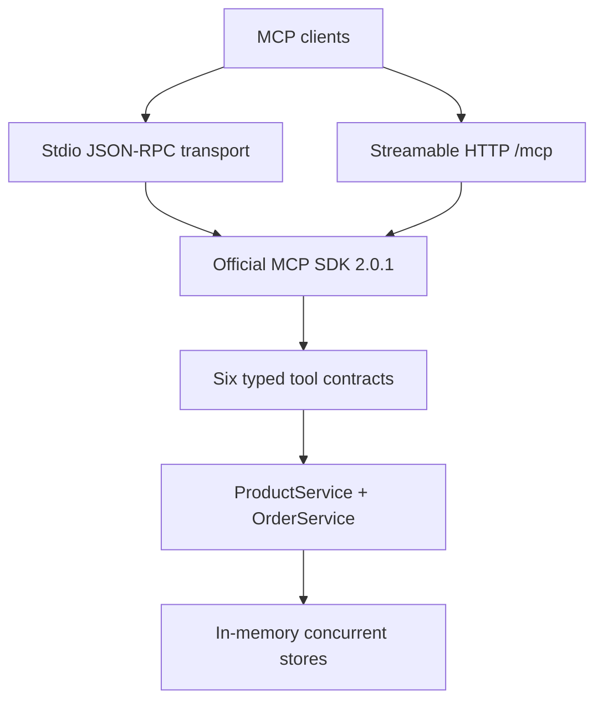

# CommerceLink

CommerceLink is a Spring Boot 3.5 application on Java 17 that exposes a sample product, inventory, and order domain as six Model Context Protocol tools. It uses the official MCP Java SDK 2.0.1 and supports both stdio clients and streamable HTTP clients at `/mcp`.

## What is MCP?

The Model Context Protocol (MCP) is a standard interface for AI clients to discover and call tools exposed by another application. CommerceLink makes a small business API available to MCP-compatible clients without requiring a live language model.

## Architecture



The domain layer has no MCP dependency. Orders reserve inventory atomically, cancellation releases reservations, shipment consumes them, and illegal status transitions return model-readable tool errors.

## Tool catalog

| Tool | Required arguments | Purpose |
|---|---|---|
| `list_products` | — | List products; optionally filter by `category`. |
| `check_stock` | `productId` | Return on-hand, reserved, and available quantities. |
| `create_order` | `customerId`, `items` | Create a pending order and reserve stock. Each item has a `productId` and positive integer `qty`. |
| `get_order` | `orderId` | Return order details and line items. |
| `update_order_status` | `orderId`, `status` | Change status subject to the legal order lifecycle. |
| `list_orders` | — | List recent orders; optional `status` and `limit` (default 20, maximum 100). |

Seed data includes eight products, three orders, an intentionally low-stock product (`p-118`), and a shipped order (`order-003`).

## Build and run locally

Requirements: Java 17+ and Docker with Compose. Maven is bootstrapped by the wrapper.

```bash
./mvnw -q package
java -jar target/commercelink-1.0.0.jar --transport http --port 8082
```

The Spring Boot Maven plugin builds the executable jar, and `CommerceLinkApplication` is annotated as a Boot application so IDEs such as VS Code's Spring Boot Dashboard can discover it. HTTP is selected explicitly above; the default transport remains stdio for MCP clients.

Open Swagger UI at [http://localhost:8082/swagger-ui/](http://localhost:8082/swagger-ui/). The UI and OpenAPI document at `/openapi.yaml` are served locally from the packaged application; no CDN access is needed.

The default transport is stdio, intended for clients that spawn CommerceLink:

```bash
java -jar target/commercelink-1.0.0.jar
```

For Claude Desktop, configure the absolute path to the built jar:

```json
{
  "mcpServers": {
    "commercelink": {
      "command": "java",
      "args": ["-jar", "/absolute/path/to/CommerceLink/target/commercelink-1.0.0.jar"]
    }
  }
}
```

HTTP mode is suitable for MCP Inspector and remote clients:

```json
{
  "mcpServers": {
    "commercelink": {
      "type": "http",
      "url": "http://localhost:8082/mcp"
    }
  }
}
```

## Run with Docker

Build and start HTTP mode:

```bash
docker compose up --build commercelink
```

If host port 8082 is already in use, set `COMMERCE_LINK_HOST_PORT` to another port, for example `COMMERCE_LINK_HOST_PORT=18082 docker compose up --build commercelink`.

Run the same Maven test suite in the Docker build environment:

```bash
docker compose run --build --rm test
```

The image can also be built and run directly:

```bash
docker build -t commercelink .
docker run --rm -p 8082:8082 commercelink
```

## Test with MCP Inspector

With HTTP mode running:

```bash
npx --yes @modelcontextprotocol/inspector --cli \
  --transport http --server-url http://localhost:8082/mcp \
  --method tools/list --format json

npx --yes @modelcontextprotocol/inspector --cli \
  --transport http --server-url http://localhost:8082/mcp \
  --method tools/call --tool-name check_stock \
  --tool-args-json '{"productId":"p-101"}' --format json
```

## API documentation

- `src/resources/CommerceLink_Spec.yaml` documents the MCP Streamable HTTP JSON-RPC endpoint (`POST /mcp`), lifecycle messages, and tool requests. The app serves this file at `/openapi.yaml` and displays it in the locally hosted Swagger UI at `/swagger-ui/`.
- `postman/CommerceLink.postman_collection.json` contains initialize/session setup, tool discovery, and example calls for all six tools. Import it into Postman and run the requests in order; the initialize request saves the session ID for later calls.

The JUnit suite includes domain tests and real MCP SDK clients connected to both the embedded HTTP server and a spawned stdio server process.

## Design notes

- The official MCP Java SDK hosts the server; LangChain4j is not used because its MCP support is client-oriented.
- Streamable HTTP uses the SDK servlet transport and embedded Tomcat. Legacy SSE endpoints are not exposed.
- Schemas declare required fields and tool handlers validate inputs. Domain errors are returned with `isError: true`; server stack traces are not exposed to clients.
- State is in-memory. Each stdio process has its own data; a running HTTP process keeps data for its lifetime.
